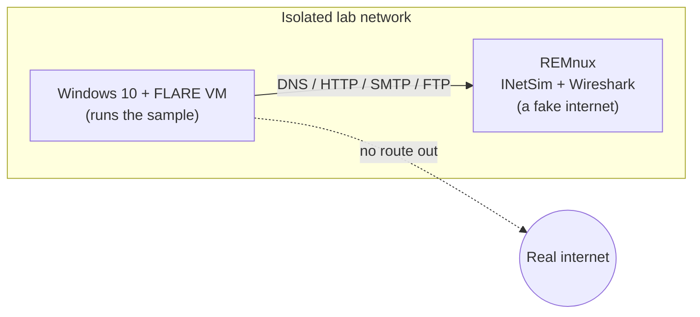

<div align="center">

# 🔬 Dissecting a .NET Loader Tagged as Agent Tesla

**A "pearl-farm app" that isn't: static and dynamic malware analysis, MITRE ATT&CK mapping and YARA detection**


[📄 Read the report](report/Agent-Tesla-Loader-Analysis.pdf) · [🗺️ ATT&CK layer](attack/layer.json) · [🛡️ YARA rules](detection/pearlfarm_loader.yar)

</div>

---

## 🎯 Overview

A file tagged **Agent Tesla** on MalwareBazaar turned out to behave like a **loader disguised as a pearl-farm management app**. About **92% of the file is image resources that look like static**, and the code contains a routine that reads bytes out of a bitmap. When I ran it in an isolated lab, it launched **PowerShell to add a Windows Defender exclusion for its own file**, and a second copy of itself started the same second.

Security vendors couldn't agree on what it is (Noon, AgentTesla, Formbook, Bladabindi), so I treated the family tag as a claim to test, not a fact.

## 🔎 What I found

| # | Finding | Evidence |
|---|---------|----------|
| 1 | It is a disguised loader, not a finished stealer | Fake "PearlFarm" product metadata and a working farm-simulator interface. None of Agent Tesla's usual behavior (credential theft, exfiltration) appears in the file |
| 2 | The payload is probably hidden in images | Three image resources make up **92.37%** of the file (`eQTo` 872,321 B, `Fee` 154,664 B). They render as noise, not pictures |
| 3 | A hex string hides the resource name | `6551546F` decodes to `eQTo`, the largest image |
| 4 | Part of the code is decoy | A 259-line "compression" method whose result cannot change what the extractor returns |
| 5 | It tries to switch off antivirus | `powershell.exe Add-MpPreference -ExclusionPath <its own file>`, seen in Procmon's process tree |
| 6 | It relaunches itself | A second copy started the same second as PowerShell |

## ⚠️ What I could not confirm

I'd rather be clear about the limits than overclaim.

- **The malware family.** The sample is *tagged* Agent Tesla, but I never reached the hidden second stage.
- **Whether the hidden data is true steganography** or raw pixel values. I did not read the pixel-reader class to the end.
- **Network behavior.** My Wireshark capture was lost when REMnux crashed.
- **Persistence.** No Run-key entries appeared, but I did not check scheduled tasks or services.
- **Whether the Defender exclusion actually worked.**

## 🧪 The lab



VirtualBox, with snapshots to return to a clean state. I confirmed the isolation by checking that pings to real addresses failed and that DNS and HTTP requests landed on INetSim's placeholder page.

## 🗺️ MITRE ATT&CK mapping (v20)

| Confidence | Techniques |
|------------|------------|
| **Observed** | Obfuscated Files or Information (T1027), Masquerading (T1036), PowerShell (T1059.001), Disable or Modify Tools |
| **Hypothesis** (tool-reported or unconfirmed in code) | Reflective Code Loading (T1620), Steganography (T1027.003), Embedded Payloads (T1027.009), Deobfuscate/Decode Files (T1140) |
| **Reported by VirusTotal's sandbox, not observed by me** | Virtualization/Sandbox Evasion (T1497) |

Open [`attack/layer.json`](attack/layer.json) in [ATT&CK Navigator](https://mitre-attack.github.io/attack-navigator/) to see the full layer with comments.

## 🛡️ Detection

Two **draft** YARA rules in [`detection/pearlfarm_loader.yar`](detection/pearlfarm_loader.yar):

- **High confidence (this build):** matches the loader's unusual class names, assembly GUID, filler array and hex delimiter. It needs several traits together, so a single common string can't trigger it.
- **Low confidence (hunting only):** flags a .NET executable whose `.text` section is almost the whole file and looks encrypted. Packed or bundled legitimate software can trigger it.

I deliberately left out the imphash, generic APIs and short strings, because they would cause false positives. The rules are not yet tested against a clean corpus.

## 📂 What's in this repo

```
├── README.md
├── report/
│   └── Agent-Tesla-Loader-Analysis.pdf   # full 75-page write-up
├── attack/
│   ├── layer.json                        # ATT&CK Navigator layer
│   └── layer.svg
└── detection/
    └── pearlfarm_loader.yar              # draft YARA rules
```

**The report covers:** lab setup and troubleshooting, static analysis (hashes, PE structure and entropy, strings, capa, decompilation), dynamic analysis (process, registry and file activity), the ATT&CK mapping, and the detection rules.

## 🧠 What I learned

- **Treat tool output as a lead, not a verdict.** capa's "analysis tools" match was really the PNG marker `IDAT`. The imphash turned out to be shared by many unrelated .NET files.
- **Collect evidence before you revert.** I lost my packet capture and had no snapshot after the network setup. The report documents this plainly, along with what I would do differently: save captures immediately, snapshot after each step, and enable Regshot's file scan.
- **Isolation takes care.** I worked through duplicate IP addresses, a firewall that silently dropped pings, and REMnux's network configuration before I trusted the lab.

## 🛠️ Skills and tools

**Skills:** malware triage, static and dynamic analysis, threat intelligence, MITRE ATT&CK mapping, detection engineering (YARA), lab design, technical reporting

**Tools:** VirtualBox, FLARE VM, REMnux, INetSim, Wireshark, Detect It Easy, PEStudio, FLOSS, capa, dnSpy, de4dot, Procmon, Process Explorer, Regshot, VirusTotal, MalwareBazaar, ATT&CK Navigator

## 🔒 Safety note

**The malware sample is not included in this repository.**
It is identified by its hash and can be downloaded from MalwareBazaar:

`SHA-256: 412bad1c87f5d4e8c3a6955e942628b9615931cc2399c2b316326d15e3a84775`

Only handle it inside an isolated virtual machine with no route to your real network.

## 👤 Author

**Adetola Samuel O.** · [GitHub](https://github.com/Cyber-Sam01) · [LinkedIn](https://linkedin.com/in/adetola-samuel-2b876a278)

---

<div align="center">
<sub>Completed October 2026 · Educational project</sub>
</div>
